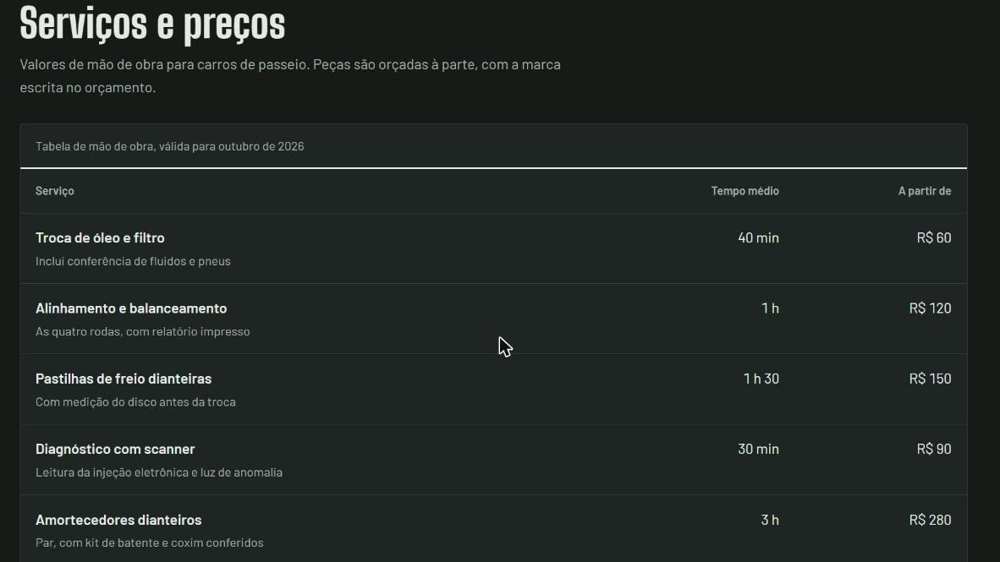

# Mecânica Bertolini

Landing page para uma oficina mecânica de bairro. É um **projeto conceitual de portfólio**: a oficina é fictícia, mas a página foi construída como se fosse para um cliente real, com conteúdo, preços e fluxo de contato pensados para um negócio local.

**Site no ar:** https://mecanica-bertolini.vercel.app


## O problema que a página resolve

Quem procura oficina tem medo de pagar por serviço que não precisava. Por isso a página foi construída em torno de transparência: orçamento por escrito antes do serviço, aprovação item por item e a peça trocada devolvida ao cliente. Cada seção existe para tirar uma dúvida que impede o visitante de chamar no WhatsApp.

## O que tem na página

- **Calculadora de próxima troca de óleo.** O visitante digita a quilometragem do carro e escolhe o tipo de óleo. A página preenche um adesivo igual ao que as oficinas colam no para-brisa, com o km e a data da próxima troca.
- **Tabela de serviços e preços** no formato de ordem de serviço, com tempo médio e valor "a partir de".
- **Botão de orçamento pelo WhatsApp** com mensagem pré-preenchida.
- **Etapas do atendimento**, do primeiro contato até a retirada do carro.
- **Garantia, horário de funcionamento e localização**, com botão para abrir no Google Maps e para copiar o número.



## Detalhes técnicos

- HTML, CSS e JavaScript puros, sem framework e sem etapa de build. Um único arquivo, `index.html`.
- Layout responsivo, de celular a desktop.
- Modo claro e escuro automático, de acordo com a preferência do sistema do visitante.
- Acessibilidade: foco visível no teclado, tabela com cabeçalhos corretos e respeito à preferência de movimento reduzido.
- Fontes do Google Fonts: Big Shoulders Display, Barlow e Caveat.

## Como rodar localmente

Não precisa instalar nada. Basta abrir o `index.html` no navegador, ou servir a pasta com qualquer servidor estático:

```bash
npx serve .
```

## Como adaptar para uma oficina real

1. Troque o número de WhatsApp nas duas constantes no topo do `<script>`: `WHATSAPP` (só dígitos, com DDI e DDD) e `WHATSAPP_EXIBIDO` (como aparece na tela).
2. Atualize serviços, tempos e preços na tabela.
3. Ajuste endereço, horário e o link do Google Maps.
4. Remova a linha "Projeto conceitual de portfólio" do rodapé.

## Publicação

O projeto está conectado à Vercel. Cada commit na branch `main` publica uma nova versão automaticamente.
